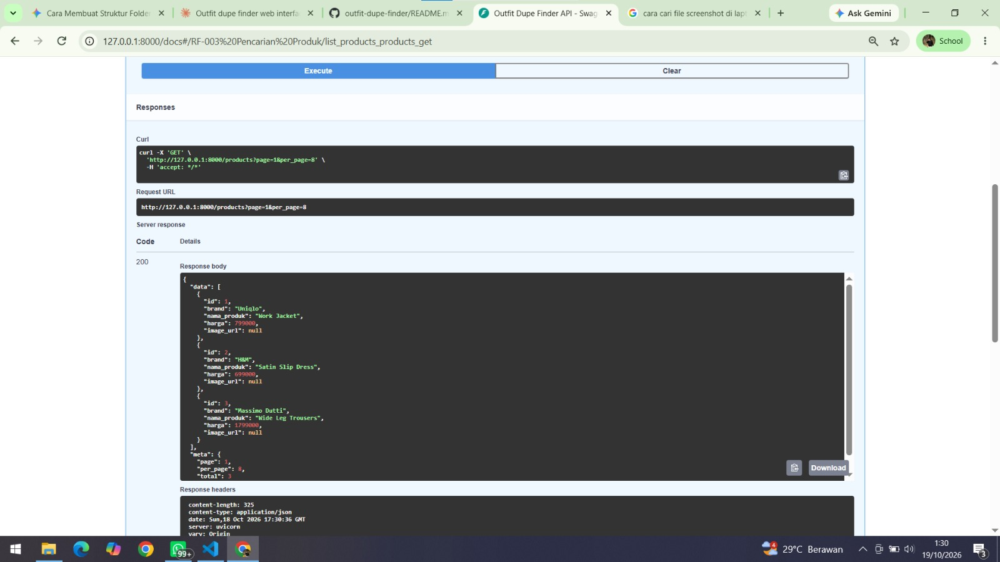
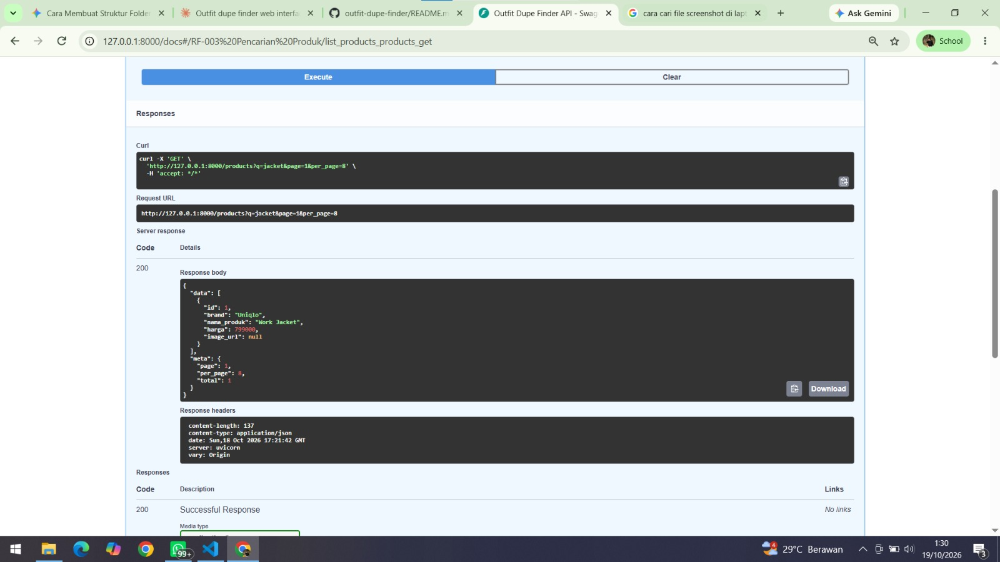
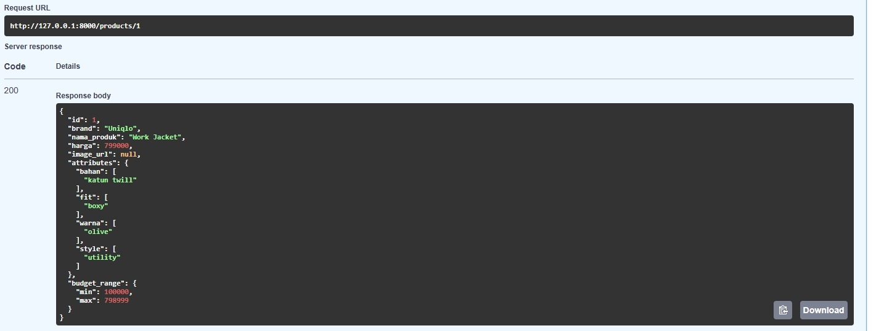
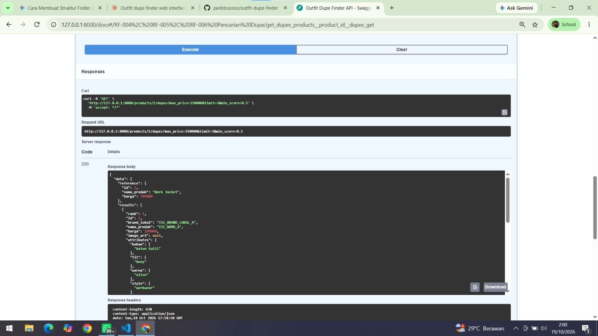
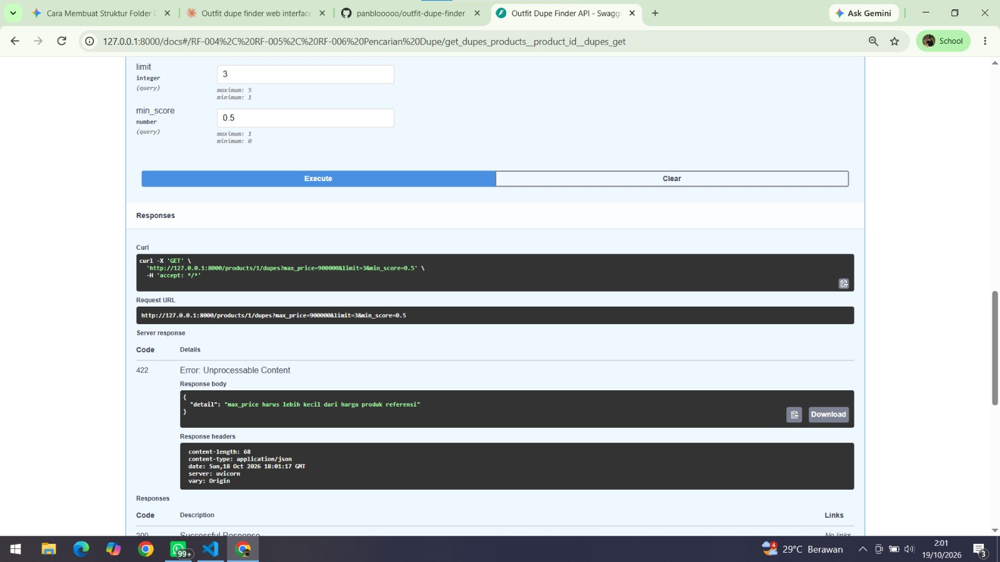
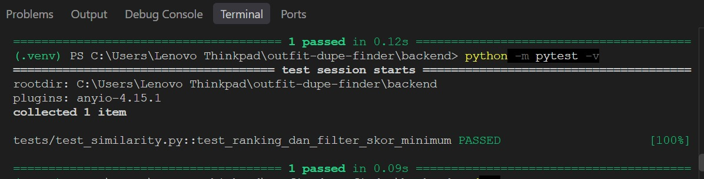

# Outfit Dupe Finder

Sistem informasi pencari alternatif busana lokal (dupe) dari produk high-end.
Sistem mencocokkan produk berdasarkan atribut (warna, bahan, potongan, style)
menggunakan Content-Based Filtering dengan Cosine Similarity.

**Pengembang:** Pandu Restu Adjie (11241073), Informatika
**Status:** Prototype UTS (backend REST API)

## Teknologi
- Python 3.13, FastAPI, SQLAlchemy
- SQLite (prototype), rencana: PostgreSQL / MySQL
- pytest untuk pengujian

## Cara Menjalankan
```bash
cd backend
python -m venv .venv
.venv\Scripts\activate
pip install -r requirements.txt
python -m app.seed
uvicorn app.main:app --reload
```
Buka dokumentasi interaktif di http://127.0.0.1:8000/docs

Menjalankan tes: `python -m pytest`

## Endpoint yang Sudah Tersedia
| Metode | Endpoint | Fungsi | Kebutuhan (SRS) |
|---|---|---|---|
| GET | `/products?q=` | Pencarian produk referensi | RF-003 |
| GET | `/products/{id}` | Detail produk dan rentang bujet | RF-004 |
| GET | `/products/{id}/dupes?max_price=` | Pencarian dupe: filter harga, Cosine Similarity, ranking Top N | RF-004, RF-005, RF-006 |

## Cara Kerja Pencocokan
1. Atribut produk diubah menjadi vektor one-hot berbobot
   (warna 35%, bahan 30%, potongan 25%, style 10%).
2. Skor kemiripan dihitung dengan Cosine Similarity.
3. Kandidat difilter: kategori sama, harga di bawah produk referensi
   dan di bawah bujet pengguna, skor minimal 0,5.
4. Hasil diurutkan dari skor tertinggi dan diambil Top N (maksimal 5).

## Progress Fitur
- [ ] RF-001 Otentikasi Administrator
- [ ] RF-002 Logout Akun Admin
- [x] RF-003 Pencarian Produk Referensi
- [x] RF-004 Filter Batas Harga (Budget Limit)
- [x] RF-005 Pencocokan Cosine Similarity
- [x] RF-006 Pemeringkatan Produk Dupe
- [ ] RF-007 Penyajian Komparasi Atribut
- [ ] RF-008 Pengalihan Affiliate Link
- [ ] RF-009 Pengelolaan Master Data Produk
- [ ] RF-010 Pengelolaan Atribut dan Pembobotan
- [ ] RF-011 Impor Massal Data

**Progress: 4/11 kebutuhan fungsional (36%), 3/5 fitur utama (60%)**

| Fitur | Status |
|---|---|
| F1 Katalog dan Pencarian | Selesai |
| F2 Detail dan Budget | Selesai |
| F3 Mesin Similarity | Selesai |
| F4 Komparasi dan Tombol Beli | Ditunda |
| F5 Admin CRUD | Ditunda |

## Catatan Data
Data produk pada `backend/app/seed.py` masih berupa data contoh untuk pengujian
prototype. Data produk lokal asli akan menggantikannya pada tahap berikutnya.

## Bukti Pengujian
**Pencarian semua produk (RF-003)**


**Pencarian dengan kata kunci (RF-003)**


**Detail produk (RF-004)**


**Pencarian dupe (RF-004, RF-005, RF-006)**


**Validasi bujet melebihi harga referensi**


**Unit test similarity**


## Dokumen
SRS dan SDD ada di folder `docs/`.